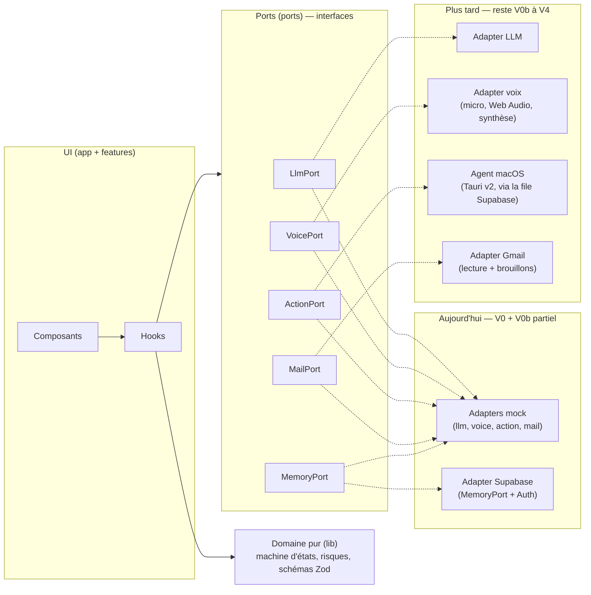

# wake-up-JARVIS

> Un **JARVIS perso**, comme dans _Iron Man_ : un assistant qui parle **français**, se souvient de tout **d'un Mac à l'autre**, et peut, un jour, lancer des commandes sur le Mac — **toujours après ta confirmation signée**.

Projet personnel de **DevinChat**, non commercial.

---

## Sommaire

1. [Vision](#1-vision)
2. [Statut actuel](#2-statut-actuel)
3. [Fonctionnalités prévues de l'UI](#3-fonctionnalités-prévues-de-lui)
4. [Architecture](#4-architecture)
5. [Stack](#5-stack)
6. [Prérequis (Mac)](#6-prérequis-mac)
7. [Installation et commandes](#7-installation-et-commandes)
8. [Arborescence](#8-arborescence-résumée)
9. [Conventions](#9-conventions)
10. [Accessibilité et reduced motion](#10-accessibilité-et-reduced-motion)
11. [Sécurité](#11-sécurité)
12. [Feuille de route](#12-feuille-de-route)
13. [Documentation](#13-documentation)
14. [Travailler avec l'équipe](#14-travailler-avec-léquipe)
15. [Licence](#15-licence)
16. [Mentions](#16-mentions)

---

## 1) Vision

JARVIS, c'est :

- **une voix en français** : tu parles, il écoute, il répond à l'écrit **et** à voix haute ;
- **une mémoire partagée entre tes Mac** : la conversation et ce qu'il sait de toi te suivent d'un Mac à l'autre ;
- **un agent terminal sécurisé** : il peut proposer une commande, mais **rien ne s'exécute** sans que tu aies vu la **commande exacte** et signé (Touch ID ou mot de passe du Mac) ;
- **« Wake up, JARVIS »** : un mot de réveil qui allume l'écran — **jamais** de déverrouillage par la voix ;
- **une interface holographique** sobre : anneau de voix, cadran, blanc nacré sur noir cendré, lisible et accessible.

## 2) Statut actuel

🚧 **Phase V0 → V0b (partiel).**

- **UI** : splash → gate auth → home ; terminal mock, panneau REPO mock, conversation, cartes d’action, `/dev/states`.
- **V0b déjà branché** : Auth Supabase **e-mail/mot de passe** (`/login`) ; `MemoryPort` → table `messages` (+ RLS) si env publique présente, sinon mock + seed local.
- **Encore mock** : LLM, voix, mails, actions, journal ; **pas** de Gmail ni d’agent terminal réel.
- **Système** : `not-found` / `error` / `global-error` brandés ; mails & mémoire gèrent loading / empty / error (+ retry).
- **Hors scope volontaire** : offline navigateur (`navigator.onLine`) — usage perso desktop.
- L'UI ne parle qu'aux **ports** ; composition dans `app/providers.tsx` via `createAppPorts()`.
- Détail décision : [ADR 0008](./docs/adr/0008-auth-email-memoire-supabase.md). Plan UI : **[PLAN-UI.md](./PLAN-UI.md)**.

## 3) Fonctionnalités prévues de l'UI

- **Intro** au premier lancement (~3,5 s) : point de lumière → anneau qui se dessine (logo JARVIS) → « JARVIS » → « Bonsoir, DevinChat » ; intro courte (~0,8 s) ensuite, ou aucune intro (réglage). « Passer », Échap, clic ou frappe l'arrêtent.
- **Conversation** centrée et lisible, réponses **toujours écrites**.
- **Saisie** : champ qui grandit, bouton micro (60 px), bouton Envoyer (44 px) ; **voix simulée** avec raccourci maintenu (**Ctrl+Maj+Espace** par défaut, réglable) ; transcription corrigeable avant envoi.
- **Anneau de voix** et ses états : Prêt, Écoute…, Réfléchit…, Parle…, Erreur, Hors ligne — toujours avec texte + icône. « Réfléchit… » = indicateur **nacré** qui tourne.
- **Écoute** : « Micro actif » affiché en permanence (dans le header et en rappel en bas), ligne fixe « Coupure auto après 15 s de silence », bouton « Couper le micro » visible.
- **Indicateur « Réveil actif »** dans le header, coupable en un clic.
- **Carte de confirmation d'action** dans la conversation : commande exacte, dossier, Mac, explication, niveau de risque (1 Lecture, 2 Modification, 3 Dangereux), « Signer et exécuter » pour les niveaux 2 et 3, expiration « Expire à HH:MM ». Pour les niveaux 2 et 3, la carte de signature montre le **texte exact qui sera signé** (payload JSON JCS v1) en entier.
- **Journal** des actions (horodaté, statut, durée, sortie dépliable, copier, filtre).
- **Mails** en lecture seule (expéditeur, objet, extrait) — factices pour l'instant.
- **Hors ligne / erreur** gérés proprement (brouillon gardé, « Réessayer »).
- **Installable** comme une app (PWA).
- **`/dev/states`** : une page qui montre tous les états (en développement uniquement).

**Direction artistique — v3 « blanc nacré »** (validée par DevinChat le 01/11/2026) :

- fond **`#0B0B0C`**, accent **`#ECEAE4`** (blanc nacré) ;
- ambre **`#F5B84A`** réservé à la **signature Touch ID** ;
- « JARVIS réfléchit » = indicateur nacré qui tourne ;
- les anciennes DA (v1 et v2, accent cyan) sont **remplacées**.

**Typographie** : IBM Plex Sans + IBM Plex Mono, auto-hébergées (CSP).

- Titre JARVIS : Plex Sans 600, capitales, `--tracking-wordmark` (0.32em).
- Titres de section : 600, capitales, `--tracking-title` (0.16em).
- Labels, statuts, boutons : 500, capitales, `--tracking-label` (0.12em).
- Corps : Plex Sans 400, sans tracking.
- Carte de signature, commandes, chemins : Plex Mono 400, sans tracking ni capitales forcées (pour distinguer l/1 et O/0).
- Les capitales viennent de `text-transform`. Exception : le label du cadran (classe `.dial`, Mono 12 px, décoratif, `aria-hidden`).

Détails : [PLAN-UI.md §3](./PLAN-UI.md) et les maquettes de [docs/design/v3/](./docs/design/v3/README.md).

## 4) Architecture

Règle d'or : **l'UI ne connaît que les ports**. Un seul fichier (`app/providers.tsx`) choisit les adapters.



Détails : [PLAN-UI.md §1.9](./PLAN-UI.md), [ADR 0001](./docs/adr/0001-ui-d-abord-ports-et-mocks.md), [ADR 0008](./docs/adr/0008-auth-email-memoire-supabase.md).

## 5) Stack

| Domaine        | Outil                                                                                                                                                       |
| -------------- | ----------------------------------------------------------------------------------------------------------------------------------------------------------- |
| Framework      | Next.js 16.4 (App Router, Server Components par défaut, Turbopack) ; code à la racine, sans `src/`                                                          |
| Langage        | TypeScript strict, zéro `any`                                                                                                                               |
| Style          | Tailwind CSS v4 via `@tailwindcss/turbopack` (tokens dans `@theme`), IBM Plex Sans + IBM Plex Mono (`next/font/google`, auto-hébergées car CSP)             |
| Animation      | GSAP + `@gsap/react` (SVG + CSS), Canvas 2D pour la voix                                                                                                    |
| Validation     | Zod                                                                                                                                                         |
| Backend (V0b)  | Supabase Auth (e-mail) + Postgres (`messages`, RLS) ; clients `@supabase/ssr`                                                                               |
| Tests          | Vitest + Testing Library, Playwright + axe                                                                                                                  |
| Lint et format | ESLint (`eslint-config-next`) + Prettier (`eslint-config-prettier`) ; Husky + lint-staged au commit                                                         |
| PWA            | `app/manifest.ts`, **seul manifest** (sans service worker pour l'instant) ; icônes `app/icon.svg`, `app/favicon.ico`, `app/apple-icon.png`, `public/icons/` |
| Hébergement    | Vercel                                                                                                                                                      |

Pourquoi ces choix : [ADR 0002](./docs/adr/0002-stack-front.md), [0003](./docs/adr/0003-pwa-manifest-seul.md), [0004](./docs/adr/0004-animations.md).

## 6) Prérequis (Mac)

Cible : **macOS uniquement** (Apple Silicon), shell **zsh** — voir [ADR 0005](./docs/adr/0005-cible-macos.md).

- **Homebrew**
- **Node.js** ≥ 24.15 (24.x LTS) ou ≥ 26 — demandé pour jsdom 30 (Vitest). Le Mac de DevinChat a la 25.5.0 : **lancer `brew upgrade node` avant que Vitest tourne** (étape 5, voir [PLAN-UI.md §1.2](./PLAN-UI.md))
- **pnpm**
- macOS 14 (Sonoma) ou plus récent pour Playwright

```zsh
brew install node      # ou ton gestionnaire de versions Node habituel
brew upgrade node      # Mac de DevinChat (Node 25.5.0) : avant que Vitest tourne
corepack enable        # active pnpm via Node (ou : brew install pnpm)
node -v && pnpm -v
```

## 7) Installation et commandes

> L'étape 1 est faite : `dev`, `build`, `start`, `lint`, `typecheck`, `format`, `format:check` et `check` marchent déjà. `e2e` arrive à l'étape 4, `test` à l'étape 5.

```zsh
pnpm install          # installer les dépendances
pnpm dev              # lancer en local → http://localhost:3000
pnpm build            # build de production
pnpm start            # lancer le build de production
pnpm lint             # ESLint
pnpm typecheck        # TypeScript strict (next typegen + tsc --noEmit)
pnpm format          # Prettier (format:check pour vérifier sans modifier)
pnpm test             # tests unitaires (Vitest) — à partir de l'étape 5
pnpm e2e              # tests de bout en bout + accessibilité (Playwright + axe) — à partir de l'étape 4
pnpm check            # toutes les vérifications d'un coup (les tests y sont ajoutés à l'étape 5)
```

En développement : ouvre **`/dev/states`** pour voir tous les états de l'UI (hors prod).

**Auth / mémoire Supabase** — copier `.env.example` → `.env.local` :

```zsh
cp .env.example .env.local
# renseigner NEXT_PUBLIC_SUPABASE_URL + publishable (ou anon) key
```

Dans le dashboard Supabase : Provider **Email** ON ; en local sans SMTP, **Confirm email** OFF.  
Flux : `/` (splash) → `/login` si anonyme → `/home` si session.

## 8) Arborescence (résumée)

```
wake-up-JARVIS/
├─ proxy.ts           # CSP à nonce + refresh session Supabase
├─ .env.example       # modèle env publique (pas de secrets)
├─ app/               # routes : /, /login, /home, not-found, error, global-error, /dev/states
├─ features/          # auth, home, intro, jarvis, actions, system, dev…
├─ components/ui/     # Button, HudModal, HudFrameBrackets, JarvisMark…
├─ lib/               # domaine + i18n + supabase/{client,server,env,updateSession}
├─ ports/             # interfaces TypeScript
├─ fixtures/          # données factices (Zod)
├─ adapters/          # mock/* + supabase/* + createAppPorts.ts
├─ supabase/          # config CLI + migrations (messages + RLS)
├─ e2e/               # Playwright
└─ docs/adr/          # ADR 0001–0008
```

Version complète : [PLAN-UI.md §1.8](./PLAN-UI.md).

## 9) Conventions

- **Écrans vs composants** : `features/` = écrans ; `components/ui/` = composants réutilisables.
- **Nommage** : composants en PascalCase (`SplashEntry.tsx`) ; hooks/model en camelCase (`useIntroTimeline.ts`). Pas de kebab-case.
- **Feature** : orchestrateur à la racine du dossier ; sous-fichiers dans `components/`, `hooks/`, `model/`.
- **Tokens** : couleurs / tracking / spacing uniquement via `@theme` (`bg-bg`, `text-accent`, `tracking-label`…). Pas de hex en dur dans l'UI.
- **i18n** : aucun libellé en dur dans l'UI — clés typées via `t("intro.skip")` (`lib/i18n/messages/fr.ts`).
- **Primitives** : un dossier par composant UI (`components/ui/Button/`, variants isolés) ; hooks partagés dans `lib/hooks/` ; hooks feature découpés (SRP).
- **Assets** : fichiers dans `public/` ; chemins importés uniquement via `@/lib/assets`.
- **L'UI ne connaît que les ports** : interdit d'importer un adapter (`@/adapters`, `@/adapters/**`, `**/adapters/**`) hors de `app/providers.tsx` (bloqué par ESLint à partir de l'étape 7).
- **Métier dans `lib/`** : fonctions pures, sans React ni navigateur, testées avec Vitest.
- **Server Components par défaut** ; `"use client"` seulement aux **points d'entrée** client (Providers, ports-context, MainScreen, IntroOverlay, SidePanel, SettingsDialog, bouton Copier, îlots de `/dev/states`). Voir [PLAN-UI.md §2.0](./PLAN-UI.md).
- **Pas de `style={…}` dans le HTML rendu au serveur** (la CSP le bloque) : classes Tailwind, ou GSAP après le montage.
- **TypeScript strict, sans `any`** (`noUncheckedIndexedAccess`, `exactOptionalPropertyTypes`…).
- **Zod aux frontières** : tout ce qui sort d'un adapter ou de `localStorage` est validé.
- **Simplicité d'abord** : aucune dépendance ni abstraction sans besoin prouvé.
- **Conventional Commits** : `feat(scope): …`, `fix: …`, `chore: …`, `test: …`, `perf: …`, `docs: …`.
- **Un commit par étape** du plan, avec `pnpm check` vert avant de commit (Husky + lint-staged vérifient les fichiers modifiés au commit).
- **Branches** : `main` toujours stable ; une branche par étape, ex. `feat/08-voice-ring-static` ; fusion dans `main` après relecture.

## 10) Accessibilité et reduced motion

- Tout se fait **au clavier**, avec un **focus visible** (contour blanc plein).
- Cibles de **44 × 44 px** minimum (bouton micro : 60 px).
- Contrastes : **4,5:1** pour le texte, **3:1** pour les contrôles (validés par SKETCH).
- **Jamais l'info par la couleur seule** : chaque état = texte + icône.
- Annonces **`aria-live="polite"`** pour les états (« Réfléchit… », « De nouveau en ligne »…). L'entrée en écoute n'y passe pas : le header l'annonce seul via `role="status"` (« Micro actif »), pour éviter une double annonce.
- **Écoute** : « Micro actif » du header porte le **seul `role="status"`** ; le rappel du bas est en `aria-hidden` ; « Couper le micro » en 14 px sur mobile.
- Texte porteur d'info **≥ 14 px**, corps **16 px**.
- Raccourcis **toujours avec un modificateur** et réglables ; le bouton micro marche toujours.
- **Reduced motion** : anneau fixe en fondu 300 ms, pas de rotation, pas de zoom ; max **3 flashs/s**.
- Tests automatiques avec **axe** + vérification à la main avec **VoiceOver**.

## 11) Sécurité

**Dès maintenant :**

- **CSP stricte** à nonce dans `proxy.ts` (layout en rendu dynamique avec `await connection()`), autres en-têtes dans `next.config.ts`, **aucun script tiers**, polices auto-hébergées.
- Pas de `dangerouslySetInnerHTML` ; tout contenu externe (réponses, sorties, mails) affiché **en texte**.
- **SVG (règles HACKER)** : aucun script, aucun attribut `on*`, pas de `style=`, pas de liens, pas de `data:`.
- **Carte de signature** : JCS brut entier, sans troncature, `dir="ltr"` ; échappements JSON et cases `U+XXXX` (caractère invisible, de contrôle ou non ASCII) dans le même style, sans ambre.
- **Aucun secret dans le dépôt** (il est public). `.env.local` et autres `.env*` sont ignorés ; **`.env.example`** (sans secrets) est versionné.

**Plus tard (phases terminal) :**

- **Ordres signés** de bout en bout (condition **C1**) : **payload signé v1** en JCS (RFC 8785) avec `v`, `order_id`, `machine_id`, `action`, `params`, `argv` (chemin absolu), `cwd` (chemin absolu), `nonce` (≥ 128 bits), `expires_at`. Le serveur résout `argv`/`cwd` depuis le catalogue ; l'agent recalcule tout et refuse au moindre octet différent ou si `v` est inconnu. Les lectures (ex. `git.status`) ne passent jamais par la signature.
- **Confirmation forte** : signature **Touch ID ou mot de passe du Mac** (WebAuthn) sur la **commande exacte** (condition **C2**).
- **Jamais de confirmation vocale** pour une action risquée.
- **Jamais de déverrouillage du Mac par la voix.**
- Journal **append-only**, arrêt d'urgence.

Détails : [PLAN-UI.md §6](./PLAN-UI.md), [ADR 0006](./docs/adr/0006-execution-terminal.md), [ADR 0007](./docs/adr/0007-mot-de-reveil.md).

## 12) Feuille de route

| Phase                              | Contenu                                                                                                                                                       |
| ---------------------------------- | ------------------------------------------------------------------------------------------------------------------------------------------------------------- |
| **V0 — UI** _(fait)_               | Interface + mocks, accessibilité, PWA, tests, terminal/REPO mock                                                                                              |
| **V0b — Branchements** _(partiel)_ | **Fait** : Auth e-mail + MemoryPort Supabase + pages système. **Reste** : LLM réel, voix réelle — toujours via adapters seulement                             |
| **V1 — Agent lecture seule**       | Agent macOS Tauri v2, file Supabase, ordres signés, actions de niveau 1 seulement                                                                             |
| **V2 — Actions**                   | Exécution après clic + Touch ID / mot de passe du Mac, multi-Mac, arrêt d'urgence                                                                             |
| **V3 — « Wake up, JARVIS »**       | openWakeWord local, `caffeinate -u` pour l'écran, déverrouillage par mot de passe ou Touch ID seulement ; reconnaissance locale ; mémoire Supabase + pgvector |
| **V4 — Gmail**                     | Lecture + brouillons (jamais d'envoi automatique)                                                                                                             |
| **V5 — Premium**                   | Voix premium + mode cinéma 3D (Three.js, optionnel)                                                                                                           |

**HACKER relit toute phase qui touche au terminal** (V1, V2, V3).

## 13) Documentation

- **[PLAN-UI.md](./PLAN-UI.md)** — le plan complet de la phase UI (stack, commandes, composants, tokens, accessibilité, 24 étapes).
- **[docs/adr/](./docs/adr/README.md)** — les décisions d'architecture (ADR 0001 à 0008) et le modèle pour en écrire.
- **[docs/design/v3/](./docs/design/v3/README.md)** — les maquettes de la DA v3 « blanc nacré » (écrans bureau, mobile, planche de composants) et leurs notes ([README-front](./docs/design/v3/README-front.md)).

## 14) Travailler avec l'équipe

| Qui           | Rôle                                                                 |
| ------------- | -------------------------------------------------------------------- |
| **DevinChat** | Code, commit et push ; valide les ADR                                |
| **PIXEL**     | Relit le front (composants, hooks, règle des ports, perf)            |
| **SKETCH**    | Relit le visuel (direction artistique, tokens, animations, captures) |
| **THE JUDGE** | Revue générale de chaque étape                                       |
| **HACKER**    | Relit **toute phase terminal** et la sécurité (C1, C2)               |

Comment avancer :

1. Prendre l'étape suivante dans [PLAN-UI.md §4](./PLAN-UI.md).
2. Créer la branche de l'étape.
3. Coder jusqu'à ce que **« Fini quand… »** soit vrai (lint, typecheck, tests, capture si visuel).
4. Un commit avec le message conventionnel proposé.
5. Demander la relecture aux bonnes personnes (colonne « Relecture » du plan).
6. Une décision structurante ? Écrire un **ADR** avec le modèle de [docs/adr/](./docs/adr/README.md).

## 15) Licence

**À choisir par DevinChat — MIT proposée**, à confirmer avant de rendre le dépôt public (ajouter alors un fichier `LICENSE`).

## 16) Mentions

**JARVIS** et **Iron Man** sont des marques et personnages appartenant à **Marvel** (The Walt Disney Company).
Ce dépôt est un **projet personnel, non commercial**, sans lien avec Marvel ni Disney.
